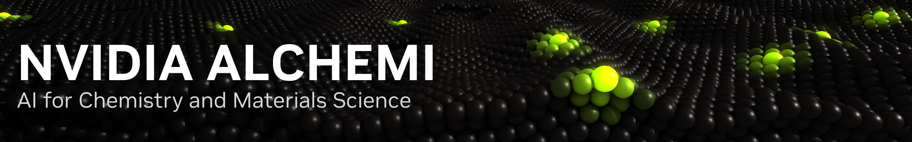

<!-- markdownlint-disable MD033 -->



# NVIDIA ALCHEMI Tutorials

Hands-on notebooks for building GPU-accelerated atomistic simulations with
NVIDIA ALCHEMI.

[Toolkit documentation](https://nvidia.github.io/nvalchemi-toolkit/) ·
[Toolkit-Ops documentation](https://nvidia.github.io/nvalchemi-toolkit-ops/)

## About ALCHEMI Toolkit

NVIDIA ALCHEMI brings together domain-specific NIM microservices, Toolkit, and
Toolkit-Ops for chemistry and materials simulation. This repository teaches the
Toolkit path through runnable notebooks.

ALCHEMI Toolkit is a GPU-first Python framework for atomic simulation. Its APIs
cover graph-aware atomic data, model wrappers, batched relaxation and molecular
dynamics, hooks, data loading, model composition, and distributed workflows.
Toolkit-Ops supplies GPU-accelerated primitives for neighbor lists, geometry
optimization, molecular dynamics, dispersion, and electrostatics.

## Start with the course tour

The course gives researchers direct evidence that ALCHEMI Toolkit can support
their own atomistic work, plus enough understanding to begin creating,
modifying, and scaling workflows themselves.

> Toolkit gives me composable building blocks to create my own chemistry or
> materials workflows, keep them GPU-resident, and run many systems efficiently
> in batches.

Begin with [Module 00: Toolkit in your research](notebooks/00-core-playbook/alchemi-core-00-quick-tour.ipynb).
In 5–10 minutes, choose research examples and watch them share one prepared
batched relaxation. The tour then opens into the two-part Core path.

The Core path is a scientific playground built around one reusable cycle:
create, run, inspect, change, and extend. Learners choose systems, run useful
calculations early, change meaningful parts, and extend the same objects into
larger workflows. Every module runs from a fresh kernel and can also be taught
on its own.

| Module | Time | Memorable idea | Learner outcome |
|---|---:|---|---|
| [1 · Toolkit fundamentals and data structures](notebooks/00-core-playbook/alchemi-core-01-data-and-batching.ipynb) | 30 min | Different chemical systems can share one GPU-resident `Batch` and one workflow. | Learn Toolkit data structures through batching, loading and saving data, and Zarr. |
| [2 · Simulate and compose](notebooks/00-core-playbook/alchemi-core-02-models-and-simulation.ipynb) | 40 min | Models, physical terms, hooks, and dynamics are building blocks learners can combine. | Use built-in and custom simulation parts: models, physical terms, watchers, dynamics, and optimization. |

The required path keeps the public Toolkit objects visible:

`ASE structures → AtomicData → Batch → model → hooks → FIRE2 → model composition`

Short optional units are labeled `⚡ Power User` and sit beside the section they
extend. Each one can be skipped without changing later required cells.

### Prerequisites

- Python and basic NumPy or PyTorch array experience
- familiarity with molecular structures and energies
- a CUDA-capable NVIDIA GPU for the full workshop results; CPU uses a shorter
  walkthrough
- the frozen environment created by `./scripts/setup`

## Install and run

### Local installation

Install [`uv`](https://docs.astral.sh/uv/), then create the saved environment
from the repository root:

```bash
./scripts/setup
```

Launch JupyterLab through the same environment:

```bash
./scripts/run jupyter lab
```

The notebook uses CUDA when a compatible NVIDIA GPU is available and selects
smaller workloads for its CPU path. [`uv.lock`](uv.lock) records the Python
environment, and
[`environment/runtime-pins.toml`](environment/runtime-pins.toml) records the
Toolkit, Toolkit-Ops, model, and data sources used by the course.

### NVIDIA Brev workshop deployment

The Brev workshop uses the repository recipe directly. A VM Mode Launchable
clones the course, installs the frozen environment into persistent workspace
storage, prewarms the runtime assets, verifies CUDA, and registers the
environment as the default Python Jupyter kernel.

Configure the Launchable to use this repository and run:

```bash
./scripts/brev-setup.sh
```

Attendees need a Brev account, their event credit code, and the Launchable
link. The complete organizer configuration, validation procedure, attendee
steps, and 100-person rehearsal plan are in
[`deployment/brev/README.md`](deployment/brev/README.md).

### Container installation

The container uses the same `uv.lock` and runtime checks as the local
installation. Its build downloads and verifies AIMNet and D3, then downloads
and loads the `medium-mpa-0` MACE checkpoint. Docker and the NVIDIA Container
Toolkit are required on the host.

Build the image with your user and group IDs so files saved from Jupyter remain
owned by your account:

```bash
docker build \
  --build-arg USER_ID="$(id -u)" \
  --build-arg GROUP_ID="$(id -g)" \
  --tag alchemi-core:local \
  .
```

Create a Jupyter token and start the container. This example publishes Jupyter
on the host loopback address at port 8893:

```bash
mkdir -p .alchemi-runtime
python3 -c 'import secrets; print(secrets.token_urlsafe(24))' \
  > .alchemi-runtime/jupyter-token
chmod 600 .alchemi-runtime/jupyter-token

docker run --detach \
  --gpus all \
  --name alchemi-core \
  --restart unless-stopped \
  --shm-size=8g \
  --publish 127.0.0.1:8893:8888 \
  --env JUPYTER_TOKEN="$(<.alchemi-runtime/jupyter-token)" \
  --volume "$PWD:/workspace" \
  alchemi-core:local
```

Check the server and the saved runtime:

```bash
docker logs alchemi-core
docker exec alchemi-core \
  ./scripts/run python environment/check_runtime.py
docker exec alchemi-core nvidia-smi
```

Open `http://127.0.0.1:8893/lab` and enter the token stored in
`.alchemi-runtime/jupyter-token`.

Use `docker stop alchemi-core` and `docker start alchemi-core` to stop
and restart the saved server.

### Connect to a remote host

When the container runs on a remote GPU host, keep its published port on the
remote loopback address. Start this tunnel in a terminal on your computer:

```bash
ssh -x -N -o ExitOnForwardFailure=yes \
  -L 127.0.0.1:8891:127.0.0.1:8893 \
  your-gpu-host
```

Keep that terminal open, then visit `http://127.0.0.1:8891/lab` and enter the
token from the remote `.alchemi-runtime/jupyter-token` file.

## Course roadmap

The current release contains the Toolkit tour and two linked Core modules. Planned course
directions include:

1. **Focused Toolkit deep dives:** Zarr and custom readers, model wrapping and
   composition, hooks and dynamics, GPU pipelines and profiling, and domain
   decomposition. These are planned as independent follow-up lessons.
2. **R&D examples:** longer adsorption and melting workflows planned for a
   future release.
3. **Domain challenges:** guided problems that apply the same Toolkit APIs to
   new scientific systems, also planned for a future release.

## Developers who shaped the tutorials

- [Ryan Reese](https://github.com/Ryan-Reese) created the melting-point study
  using NVIDIA ALCHEMI Toolkit.
- [Anoushka Bhutani](https://github.com/anoushka2000) developed companion
  tutorial challenges planned for a future release.

## License

NVIDIA-authored source and course diagrams are licensed under Apache 2.0. See
[LICENSE](LICENSE). The pinned NCI Atlas source states CC-BY; its exact license
version needs confirmation before redistribution. The interactive viewer
carries BSD and MIT notices. The NVIDIA course banner and NVIDIA marks are
excluded from the Apache grant.

Installed packages, model checkpoints, CUDA components, and generated D3 data
use their own terms. Review
[THIRD_PARTY_NOTICES.md](THIRD_PARTY_NOTICES.md),
[SOURCES_AND_LICENSES.md](SOURCES_AND_LICENSES.md), and the README beside each
input before redistribution. A published container needs a separate
image-level license inventory and notice set.
